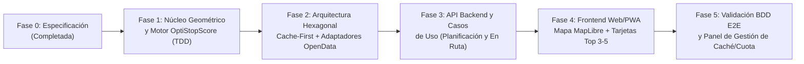

# 05. Roadmap y Matriz de Trazabilidad de Tareas (SDD)

**Proyecto:** OptiStop  
**Metodología:** Spec-Driven Development (SDD)  
**Regla de Oro SDD:** *Ninguna tarea de código se considera completada si no cumple su contrato en `specs/` y pasa su criterio de verificación asociado.*

---

## 1. Visión General del Roadmap por Fases

---

## 2. Matriz de Trazabilidad de Requisitos a Tareas (Requirements Traceability Matrix)

| ID Requisito | Descripción del Requisito | Especificación de Referencia | Tareas Asociadas | Gate de Verificación (Test / Criterio) |
| :--- | :--- | :--- | :--- | :--- |
| **RF-01** | Cálculo de ruta base y geocodificación a coste \$0 | `01-PRD §3.1`, `03-Contracts §2` | `T-1.1`, `T-2.2`, `T-3.1` | Test de integración de `OSRMRoutingAdapter` + fallback geométrico Haversine |
| **RF-02** | Recorte de "Ventana de Parada" (por tiempo, franja horaria o km) | `01-PRD §3.2`, `02-Scoring §1` | `T-1.2`, `T-1.3` | Test unitario `corridor-slicer.spec.ts` (extracción exacta de sub-polilínea $[T_{\min}, T_{\max}]$) |
| **RF-03** | Descubrimiento Híbrido Cache-First (BD Propia + Overpass OSM + Google Quota-Guarded) | `01-PRD §3.3`, `03-Contracts §2` | `T-2.1`, `T-2.3`, `T-2.4` | Test `cache-first-discovery.spec.ts`: verifica que la 2ª consulta al mismo tramo hace `CACHE_HIT` (0 llamadas externas) |
| **RF-04** | Cálculo real de desvío ida y vuelta ($\Delta t_{\text{detour}}$) y tipo de acceso/sentido | `01-PRD §3.4`, `02-Scoring §2` | `T-1.4`, `T-2.2` | Test `detour-calculator.spec.ts` validando penalizaciones por `DIRECT_SERVICE_AREA` vs `TOWN_ENTRY` |
| **RF-05** | Ranking Top 3–5 mediante `OptiStopScore` (Desvío + Bayesiana + Precio + Servicios) | `01-PRD §3.5`, `02-Scoring §3-5` | `T-1.5`, `T-1.6` | Test `optistop-scorer.spec.ts`: verifica que $4.5\star$ (800 reseñas) gana a $4.9\star$ (5 reseñas) y pondera el desvío |
| **RF-06** | Tarjeta de Parada Óptima completa + Deep links 1-Click (Google Maps, Waze, Apple Maps) | `01-PRD §3.6`, `04-UI/UX §1.3` | `T-1.7`, `T-4.3`, `T-4.4` | Test de generación de URLs de navegación y renderizado de badges (EV, Gasolinera, Precio, Desvío) |
| **RNF-01** | Presupuesto \$0 inicial con *Quota Guard* y arquitectura evolutiva | `01-PRD §5`, `03-Contracts §2` | `T-2.4`, `T-5.2` | Test de *Circuit Breaker / Quota Guard* que bloquea llamadas de pago si no hay API key o se alcanza el tope gratuito |
| **RNF-02** | Resiliencia y tiempo de respuesta ($< 500\text{ ms}$ en caché/fallback) | `01-PRD §5` | `T-2.1`, `T-2.2`, `T-3.2` | Simulación de caída de OSRM/Overpass verificando respuesta ininterrumpida desde BD curada |
| **RNF-03** | Experiencia Dual Responsive: Escritorio (*Planificación*) y Móvil (*En Ruta Copiloto*) | `01-PRD §2`, `04-UI/UX §1.1` | `T-4.1`, `T-4.2`, `T-5.1` | Validación de los escenarios Gherkin de `01-product-requirements.md` |

---

## 3. Distribución Detallada de Tareas por Fase (Backlog SDD)

### Fase 1: Fundamentos del Proyecto y Motor Matemático del Dominio (`specs/02`)
> **Objetivo:** Implementar el corazón algorítmico puro en TypeScript (sin dependencias de red ni UI) y validarlo al 100% con tests unitarios en Vitest antes de tocar APIs o pantallas.

- **[x] `T-1.1` Setup del proyecto y entorno de testing SDD:**
  - Inicializar aplicación Next.js (App Router) + TypeScript estricto + Tailwind CSS + Vitest.
  - Crear la estructura de carpetas hexagonal: `src/domain/`, `src/application/`, `src/infrastructure/`, `src/presentation/`.
- **[x] `T-1.2` Modelos y Contratos de Dominio (`src/domain/models/`):**
  - Implementar todas las entidades y puertos definidos en `specs/03-data-and-api-contracts.md` (`RoadStopEntity`, `EvaluatedOptimalStop`, `IRoutingPort`, `IStopCacheRepositoryPort`, `IExternalStopProviderPort`).
- **[x] `T-1.3` Motor Geométrico de Recorte de Ventana (`src/domain/geometry/corridor-slicer.ts`):**
  - Implementar funciones Haversine, interpolación de polilínea acumulada (tiempo y distancia), extracción del sub-tramo $[T_{\min}, T_{\max}]$ o $[D_{\min}, D_{\max}]$, proyección ortogonal de paradas sobre el tramo y filtro de sentido de marcha (para descartar paradas que ya quedaron atrás en el modo *En Ruta*).
- **[x] `T-1.4` Calculadora de Desvío Ida y Vuelta (`src/domain/scoring/detour-calculator.ts`):**
  - Implementar el cálculo de tiempo extra de salida y reincorporación a la vía ($\Delta t_{\text{detour}}$) y los modificadores por `accessType` (`DIRECT_SERVICE_AREA`, `HIGHWAY_EXIT_EASY`, `OPPOSITE_DIRECTION_OVERPASS`, `TOWN_ENTRY`).
- **[x] `T-1.5` Algoritmo de Calidad Ponderada Bayesiana y Precio (`src/domain/scoring/bayesian-quality.ts`):**
  - Implementar la fórmula Bayesiana $R_{\text{bayes}} = \frac{vR + mC}{v+m}$ ($m=50, C=3.8$) y el cálculo de relación calidad/precio (`€`, `€€`, `€€€`).
- **[x] `T-1.6` Motor Maestro `OptiStopScore` y Generador de Motivos (`src/domain/scoring/optistop-scorer.ts`):**
  - Implementar la fórmula combinada ($40\%$ desvío, $35\%$ calidad Bayesiana, $15\%$ valor/ventana, $10\%$ servicios anexos), filtrado estricto cuando el usuario exige un servicio (ej. cargador EV obligatorio) y generación automática de `matchReasons`.
- **[x] `T-1.7` Generador de Deep Links de Navegación (`src/domain/navigation/deep-links.ts`):**
  - Construir enlaces universales de 1 toque para **Google Maps** (con waypoint en ruta o destino directo), **Waze** y **Apple Maps**.
- **[x] `T-1.8` Suite de Tests de Especificación de Dominio (`tests/domain/*.spec.ts`):**
  - Ejecutar y pasar el 100% de los tests unitarios contra las fórmulas de `specs/02-domain-and-scoring-spec.md`.

---

### Fase 2: Arquitectura Hexagonal "Cache-First" y Adaptadores de Datos (`specs/03`)
> **Objetivo:** Construir la base de datos propia de paradas de carretera y los adaptadores gratuitos/conmutables con caché persistente por tramo.

- **[x] `T-2.1` Repositorio Propio Cache-First y Semilla Curada (`src/infrastructure/persistence/`):**
  - Implementar `StopCacheRepository` (persistencia local JSON/SQLite lista para migrar a PostgreSQL/Supabase) con cálculo de `corridorHash`.
  - Poblar el dataset semilla curado con áreas de servicio, ventas, asadores y cafeterías reales en los principales corredores (`A-1`, `A-2`, `A-3`, `A-4`, `A-5`, `A-6`, `AP-7`, `A-66`), incluyendo detalles de cargadores EV cercanos, gasolineras en el mismo área, precios, reseñas y tipo de acceso.
- **[x] `T-2.2` Adaptador de Rutas Open-Source (`src/infrastructure/routing/osrm-routing.adapter.ts`):**
  - Conectar con el motor público de `OSRM` para obtener geometría y tiempos reales por tramo, e incluir *fallback* geométrico instantáneo si el usuario está sin cobertura o el servidor público tarda más de $2.5\text{ s}$.
- **[x] `T-2.3` Adaptador OpenStreetMap / Overpass (`src/infrastructure/providers/overpass-osm.adapter.ts`):**
  - Consultar dinámicamente `Overpass API` en tramos nuevos para descubrir restaurantes/áreas de servicio y cruzar espacialmente si tienen una gasolinera (`amenity=fuel`) o cargador EV (`amenity=charging_station`) a menos de $300\text{ m}$.
- **[x] `T-2.4` Adaptador `GooglePlacesQuotaGuardedAdapter` (`src/infrastructure/providers/google-places.adapter.ts`):**
  - Dejar implementado el adaptador opcional para Google Places API (New) protegido por un **Quota Guard** configurable (desactivado por defecto para coste \$0, o activable con API Key respetando un límite estricto de llamadas gratuitas al mes y guardando el resultado en la BD propia).
- **[x] `T-2.5` Tests de Integración de Caché y Adaptadores (`tests/infrastructure/*.spec.ts`):**
  - Verificar el flujo *Read-Through Cache* y el respeto estricto de cuotas.

---

### Fase 3: Casos de Uso y API Backend (`specs/01` y `specs/03`)
> **Objetivo:** Exponer la lógica mediante endpoints tipados y rápidos para ambos modos de uso (*Planificación* y *En Ruta*).

- **[x] `T-3.1` Caso de Uso `FindOptimalStopsUseCase` (`src/application/use-cases/find-optimal-stops.use-case.ts`):**
  - Orquestar: cálculo de ruta $\to$ recorte de ventana (*Tiempo*, *Franja Horaria* o *Distancia*) $\to$ consulta `Cache-First` $\to$ enriquecimiento bajo demanda $\to$ evaluación `OptiStopScore` $\to$ retorno del Top 3–5.
- **[x] `T-3.2` Endpoint `POST /api/routes/optimal-stops` y `GET/POST /api/stops`:**
  - Implementar la ruta de API en Next.js con validación de parámetros, métricas de caché (`cacheHit`, latencia, fuentes utilizadas) y endpoint para permitir añadir/curar nuevas paradas en la base de datos propia.
- **[x] `T-3.3` Endpoint de Geocodificación / Autocompletado (`GET /api/geocode`):**
  - Integrar búsqueda de localidades y carreteras con **Nominatim (OSM)** + diccionario rápido de ciudades y puntos kilométricos en caché.

---

### Fase 4: Interfaz Web / PWA Interactiva (`specs/04`)
> **Objetivo:** Construir una experiencia visual rápida, clara en escritorio para planificar viajes y ergonómica en móvil para cuando ya se está en carretera.

- **[x] `T-4.1` Panel de Control Dual (*Modo Planificación* vs *Modo En Ruta GPS*):**
  - **Modo Planificación:** Selector de Origen/Destino, rutas rápidas de prueba con 1 clic, hora de salida y selector de **Ventana de Parada** (por minutos de viaje, franja horaria como *"Comer entre 14:00 y 15:00"*, o kilómetros).
  - **Modo En Ruta (Copiloto):** Botón de geolocalización GPS real (o simulador de posición en carretera), selector de destino/autovía y botones táctiles grandes (*"Parar en 15–30 min"*, *"En 45 min"*, *"En 1 hora"*).
- **[x] `T-4.2` Filtros de Características y Servicios Anexos:**
  - Chips interactivos para filtrar o priorizar: `⚡ Cargador EV cercano`, `⛽ Gasolinera en el mismo área`, `🐾 Mascotas / Terraza`, `🧸 Zona infantil`, `🅿️ Parking fácil`, y filtro de nivel de precio (`€` - `€€€`) y desvío máximo tolerable.
- **[x] `T-4.3` Mapa Interactivo con Tramo de Ventana Iluminado (`MapLibre GL JS`):**
  - Pintar la polilínea completa de la ruta, resaltar en color brillante el **sub-tramo exacto de la ventana de parada**, y mostrar los pines numerados `#1` a `#5` con popup interactivo.
- **[x] `T-4.4` Componente `OptimalStopCard` (Tarjetas del Top 3–5):**
  - Mostrar: Medalla de ranking, `OptiStopScore (0-100)`, badge de **tiempo real de desvío ida y vuelta (`+X min`)**, tipo de acceso en la vía, nota ponderada Bayesiana vs media real y volumen de reseñas, especialidad gastronómica, iconos de servicios anexos y **botones de 1 toque para abrir navegación en Google Maps, Waze y Apple Maps**.

---

### Fase 5: Verificación BDD, Telemetría de Coste \$0 y Cierre de Especificación
> **Objetivo:** Comprobar extremo a extremo los escenarios Gherkin del PRD y ofrecer transparencia del sistema *Cache-First*.

- **[x] `T-5.1` Indicador de Estado de Arquitectura & Caché (Developer/Admin Drawer):**
  - Pequeño panel informativo en la UI que muestra si la búsqueda se resolvió al 100% desde la **Base de Datos Propia (`$0.00 - Cache Hit`)**, cuántas paradas curadas u OSM se evaluaron en el corredor, y un formulario modal para que puedas **añadir nuevas paradas curadas** desde la propia interfaz.
- **[x] `T-5.2` Ejecución de Tests de Aceptación BDD (`tests/e2e/bdd-scenarios.spec.ts`):**
  - Validar automáticamente los escenarios Gherkin definidos en `specs/01-product-requirements.md`.
